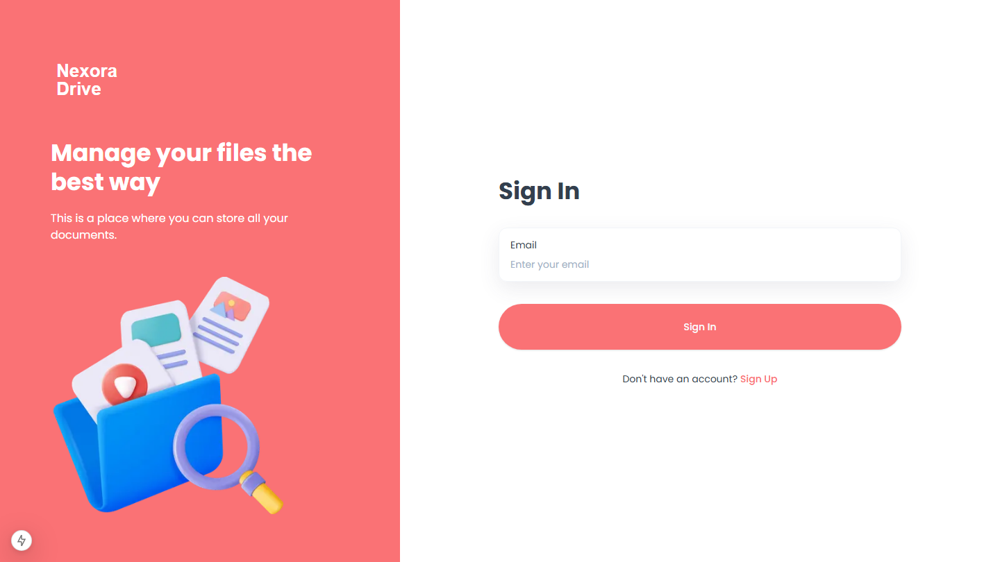

<div align="center">

# Nexora Drive

A modern file storage and sharing app built with Next.js and Appwrite.



</div>

## Features

- **Passwordless authentication**: sign up and sign in with your email and a one-time passcode (OTP).
- **File uploads**: drag and drop or pick files, with an upload progress list and a 50 MB per-file limit.
- **Organised views**: Dashboard, Documents, Images, Media and Others, with files categorised by type.
- **Search and sort**: debounced search by file name and sorting by date, name or size.
- **File actions**: rename, view details, share with other users by email, download and delete.
- **Storage dashboard**: usage chart and per-category totals against a 2 GB quota.
- **Responsive UI**: desktop sidebar and mobile navigation drawer.

## Tech Stack

- [Next.js 15](https://nextjs.org/) (App Router, Server Actions, Turbopack)
- [React 19](https://react.dev/) and [TypeScript](https://www.typescriptlang.org/)
- [Appwrite](https://appwrite.io/) (Auth, TablesDB, Storage) via `node-appwrite`
- [Tailwind CSS](https://tailwindcss.com/) and [shadcn/ui](https://ui.shadcn.com/) (Radix UI)
- [React Hook Form](https://react-hook-form.com/) with [Zod](https://zod.dev/)
- [Recharts](https://recharts.org/) and [react-dropzone](https://react-dropzone.js.org/)

## Getting Started

### Prerequisites

- Node.js 18.18 or later
- An [Appwrite Cloud](https://cloud.appwrite.io/) account

### 1. Install dependencies

```bash
npm install
```

### 2. Set up Appwrite

Create a project, then:

1. **Database**: create a database with two tables.
   - `users`: `fullName` (string), `email` (email), `avatar` (url), `accountId` (string).
   - `files`: `name` (string 255), `url` (url), `type` (enum: `document`, `image`, `video`, `audio`, `other`), `bucketField` (string 255), `accountId` (string 255), `owner` (relationship to `users`, many-to-one), `extension` (string 255), `size` (integer), `users` (**string array**, 255).
2. **Storage**: create a bucket for the uploaded files.
3. **API key**: create a server API key with the Users, Databases/Tables, Files and Sessions scopes.
4. **Auth**: enable the Email OTP flow (email/password with token sessions) and a working messaging provider so OTP emails are delivered.

### 3. Configure environment variables

Copy `.env.example` to `.env` and fill in your values:

```env
NEXT_PUBLIC_APPWRITE_ENDPOINT="https://cloud.appwrite.io/v1"
NEXT_PUBLIC_APPWRITE_PROJECT=""
NEXT_PUBLIC_APPWRITE_DATABASE=""
NEXT_PUBLIC_APPWRITE_USERS_COLLECTION=""
NEXT_PUBLIC_APPWRITE_FILES_COLLECTION=""
NEXT_PUBLIC_APPWRITE_BUCKET=""
NEXT_APPWRITE_KEY=""
```

`NEXT_APPWRITE_KEY` is a secret. Never commit your `.env` file.

### 4. Run the app

```bash
npm run dev
```

Open [http://localhost:3000](http://localhost:3000).

## Scripts

| Command         | Description                      |
| --------------- | -------------------------------- |
| `npm run dev`   | Start the dev server (Turbopack) |
| `npm run build` | Create a production build        |
| `npm start`     | Run the production build         |
| `npm run lint`  | Lint the codebase                |

## Project Structure

```text
app/            Routes: (auth) sign-in/sign-up, (root) dashboard and [type] pages
components/     UI components (uploader, cards, charts, modals) and shadcn/ui
lib/actions/    Server actions for users and files
lib/appwrite/   Appwrite client and configuration
constants/      Navigation, action menus and file-type constants
types/          Shared TypeScript types
public/         Icons, images and README assets
```

## Troubleshooting

- **`Invalid document structure: Missing required attribute`**: the attribute names in your Appwrite `files` table must match the ones above exactly (for example `bucketField`).
- **`Attribute "users" has invalid type`**: `users` must be a string **array** column.

## License

This project is for learning and personal use.
